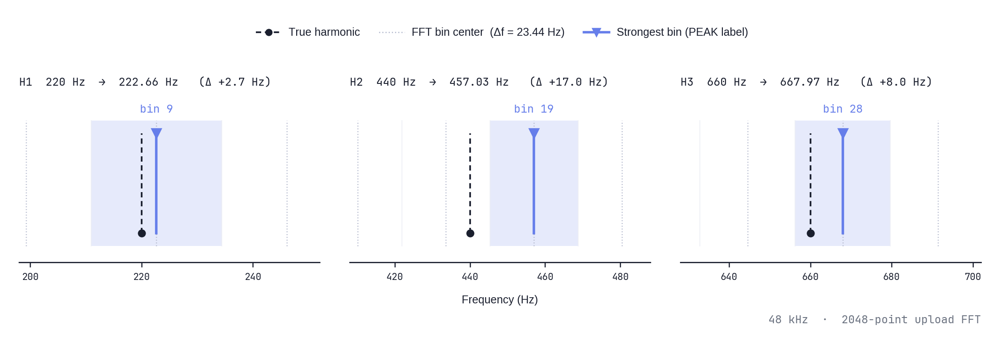

When you look at [Vocal Spectrum](/audio-spectrum-analyzer/) during practice, the bars feel like they should sit exactly on the harmonics you are singing. They do not — not because the graph is “wrong,” but because the tool draws **FFT bins** on a **log frequency axis**, not a physics textbook list of overtone frequencies. This article uses **four reproducible WAV files** (220 Hz fundamental, known harmonic levels) to answer one question: **where do those harmonics actually show up on upload, and when does the PEAK readout disagree with the note you think you sang?**

The tones are not a voice. They are three-second, 48 kHz, 16-bit mono signals with 20 ms fades, the same family as the [quiet level ladder](/blog/2026-10-28-quiet-pitch-detection-level-ladder-test/) and [Pitch gate upload test](/blog/2026-10-20-upload-pitch-gate-reanalysis-test/). We generated them with `scripts/make_spectrum_harmonic_fixture_wavs.py` and simulated the **upload analysis path** in `analyze_uploaded_file` (2048-point FFT, Hann window, 25 ms hop) as implemented in the site code. Numbers below come from [`harmonic-fixture-results.json`](/blog/assets/vocal_spectrum/harmonic-fixture-results.json).

**Download WAV** (upload from Vocal Pitch Monitor or Vocal Spectrum, then scrub playback to the steady middle):

<a href="/static/samples/spectrum-harmonics/balanced-h2-h3.wav" download="balanced-h2-h3.wav">balanced (1.0 / 0.35 / 0.15)</a> ·
<a href="/static/samples/spectrum-harmonics/strong-second.wav" download="strong-second.wav">strong 2nd</a> ·
<a href="/static/samples/spectrum-harmonics/weak-fundamental.wav" download="weak-fundamental.wav">weak fundamental</a> ·
<a href="/static/samples/spectrum-harmonics/second-dominant.wav" download="second-dominant.wav">2nd dominant</a>

## What the tool is actually plotting

[Vocal Spectrum](/audio-spectrum-analyzer/) shows **short-window FFT magnitude in dBFS**. Each vertical bar (in Bar mode) is the **maximum dB** among the raw FFT bins that fall inside that bar’s log-spaced frequency interval between your Low and High settings. The four chips above the graph summarize the **current frame** inside the same band after the **Spectrum floor** (sensitivity) filter:

- **PEAK** — frequency label of the **single strongest bin** in the band (not a sub-bin interpolation).
- **LEVEL** — that bin’s dBFS.
- **CENTROID** — amplitude-weighted mean frequency of bins above the floor.
- **RMS** — root mean square of linear amplitudes of those bins; not loudness in LUFS or SPL.

That definition matters for harmonics. A pure 440 Hz sine would still be reported at the **center frequency of whichever FFT bin won**, which is spaced every **Δf = sample_rate / FFT_size** on the upload path. For 48 kHz and a 2048-point transform, **Δf ≈ 23.44 Hz**, so bin centers step 222.66 Hz, 246.09 Hz, 269.53 Hz, … — not “every harmonic of 220 Hz.”

**Live microphone** analysis uses the browser `AnalyserNode` at **4096** FFT size (finer bins, ~11.72 Hz at 48 kHz). **Uploaded takes** stored for replay use the **2048** pipeline above. Comparing a mic screenshot to an uploaded WAV without noticing that split will look like a disagreement even on the same tone.

For background on reading the graph in practice, see [What Is the Vocal Spectrum](/blog/2026-05-09-vocal-spectrum/) and [PEAK, LEVEL, CENTROID, RMS](/blog/2026-05-18-spectrum-peak-level-centroid-rms/). Pitch tracking is a separate path; use [Vocal Pitch Monitor](/vocal-pitch-monitor/) for note accuracy, not PEAK alone.

## Four fixtures: same pitch, different harmonic balance

All four files share **F0 = 220 Hz (A3 at A4 = 440 Hz)**. Relative harmonic amplitudes before normalization:

| Fixture | 1× (220 Hz) | 2× (440 Hz) | 3× (660 Hz) |
|---|---:|---:|---:|
| balanced-h2-h3 | 1.00 | 0.35 | 0.15 |
| strong-second | 1.00 | 0.95 | 0.12 |
| weak-fundamental | 0.25 | 1.00 | 0.35 |
| second-dominant | 0.08 | 1.00 | 0.22 |

Peak sample value is 0.4 full scale in each file. Only the **first three** harmonics are in the waveform; there is no energy at 880 Hz in the generator, so energy near 880 Hz in the table is leakage and noise floor, not a fourth harmonic we added.

We analyzed the **middle analysis frame** of each upload (after the same 0.8/0.2 temporal smoothing used during file import). Default stats band **80 Hz–16 kHz** and default sensitivity (~50% slider position, floor about **−37.9 dBFS**) match a fresh Vocal Spectrum panel unless you changed Low–High or Spectrum floor.

## Where harmonics land in FFT bins (upload path)

True harmonic frequencies are exact multiples: 220, 440, 660, 880 Hz. Each bin is labeled at its **center** frequency: (bin index + ½) × 23.4375 Hz at 48 kHz upload analysis. The table lists, for each harmonic, the **strongest bin within ±2 neighbors** of the expected index.

| Fixture | H1 target 220 Hz → bin center (dBFS) | H2 target 440 Hz → bin center (dBFS) | H3 target 660 Hz → bin center (dBFS) |
|---|---|---|---|
| balanced-h2-h3 | **222.66 Hz** (−16.4) | **457.03 Hz** (−24.9) | **667.97 Hz** (−32.2) |
| strong-second | 222.66 Hz (−19.2) | **457.03 Hz** (−19.1) | 667.97 Hz (−36.9) |
| weak-fundamental | 222.66 Hz (−29.0) | **457.03 Hz** (−16.4) | 667.97 Hz (−25.4) |
| second-dominant | 222.66 Hz (−37.1) | **457.03 Hz** (−14.6) | 667.97 Hz (−27.6) |

Three patterns show up immediately:

1. **The fundamental never reports as exactly 220 Hz.** It clusters on the **222.66 Hz** bin center (~+2.7 Hz offset). That is normal bin snapping, not a tuning error in the file.
2. **The second harmonic does not label as 440 Hz.** Its energy peak sits on the **457.03 Hz** bin center (~+17 Hz vs 440). True 440 Hz falls *between* bin centers at this FFT size; the UI label is the **bin center**, not the continuous peak frequency you would get from a curve fit.
3. **The third harmonic is closer in label space:** **667.97 Hz** vs 660 Hz (~+8 Hz), still not exact.

So the bars **track the harmonic series in shape** (energy at roughly 1×, 2×, 3×), but **numeric PEAK and bar positions follow FFT grid + log bar grouping**, not perfect Hz labels on the overtone list.

  

  <em>True harmonics at 220, 440, and 660 Hz versus the 2048-point FFT bins used as PEAK labels (222.66, 457.03, 667.97 Hz) at 48 kHz upload analysis</em>

## When PEAK names the second harmonic instead of the fundamental

PEAK picks the **loudest bin** in the band, not “the fundamental by rule.” With the balanced fixture (weak 2nd and 3rd), PEAK reads **222.66 Hz** — the fundamental bin wins. As soon as the second harmonic is within a few dB of the first, PEAK jumps to the **457.03 Hz** bin:

| Fixture | PEAK (Hz) | LEVEL (dBFS) | CENTROID (Hz) |
|---|---:|---:|---:|
| balanced-h2-h3 | **222.66** | −16.4 | 319 |
| strong-second | **457.03** | −19.1 | 347 |
| weak-fundamental | **457.03** | −16.4 | 472 |
| second-dominant | **457.03** | −14.6 | 485 |

That matches what many singers see on a bright vowel or a close mic: **the graph still shows a low stack of bars**, but the **PEAK chip names an overtone** near the second harmonic. It does not mean you “sang an octave high” in pitch-tracker terms; it means **more energy landed in that bin** for this window. [Vocal Pitch Monitor](/vocal-pitch-monitor/) uses autocorrelation on the same upload, not the FFT PEAK, which is why the two tools can disagree in label even on one file — a topic the planned A1 octave-error post addresses directly.

CENTROID shifts upward when upper harmonics dominate (472–485 Hz on the weak-fundamental and second-dominant files) even though the fundamental is still present. CENTROID is a **balance meter**, not a note name.

## Log-scale bars add another layer

Between 80 Hz and 16 kHz, Bar mode does not draw one bar per FFT bin. It divides the log axis into canvas-width bands and, for each band, takes the **max dB** among bins in that Hz interval. A narrow harmonic can **share a bar** with its neighbor or look “smeared” if the bar spans several bins. Zooming Low–High (for example 125–2000 Hz for a mid voice check) changes both **which bins exist in view** and **how many bins each bar eats**, so the same upload can look sharper or flatter without any change in the audio.

For view-mode behavior, see [Bar, Line, and Circle](/blog/2026-05-22-spectrum-bar-line-circle-view/). Peak-hold keeps a recent maximum visible for ~1.7 s; a consonant spike can linger on the graph after the sound itself moved on.

## Limits of this experiment

- **Synthetic steady tones only.** Vowels, formants, breath noise, vibrato, and reverb spread energy across many bins; PEAK can wander frame to frame.
- **Upload vs live mic FFT sizes differ** (2048 vs 4096). Repeat the WAV test on upload; use live mic for room and performance conditions, not as a pixel match to the JSON table.
- **We did not tune Low–High or sensitivity** per file. Raising the Spectrum floor can hide weak harmonics and change PEAK without changing your voice.
- **Harmonic amplitudes in real singing** are not fixed ratios; comparing your voice to these WAVs is about **mechanism**, not target bar heights.

## Repeat the test in MusicalBoard

1. Download one WAV above (or all four).
2. Open [Vocal Pitch Monitor](/vocal-pitch-monitor/) or [Vocal Spectrum](/audio-spectrum-analyzer/) and **upload** the file (same analysis backend).
3. After analysis finishes, **play** and pause near the **middle second** of the tone.
4. With Low **80 Hz**, High **16 kHz**, and default sensitivity, read **PEAK** and compare to the table. Try **125–2000 Hz** and watch how bar density changes.
5. Optionally regenerate numbers: `python3 -I scripts/make_spectrum_harmonic_fixture_wavs.py` from the project repository.

If PEAK sits near **457 Hz** on a file you know is A3, check harmonic balance and FFT labeling before assuming an octave mistake. For mixed recordings where the line jumps register, start with [Why Pitch Jumps on a Mixed Vocal](/blog/2026-10-09-why-pitch-jumps-on-a-mixed-vocal/) and separation on [Vocal Isolator](/vocal-isolation/).

**Bottom line:** On a known 220 Hz harmonic series, Vocal Spectrum places energy on the expected **regions** (1×, 2×, 3×), but **reported frequencies are bin centers on a coarse grid**, and **PEAK follows the strongest bin**, which is often the second harmonic when it is loud. That is the tool behaving as designed — useful for comparing takes at the same settings, not for reading exact overtone Hz without context.
