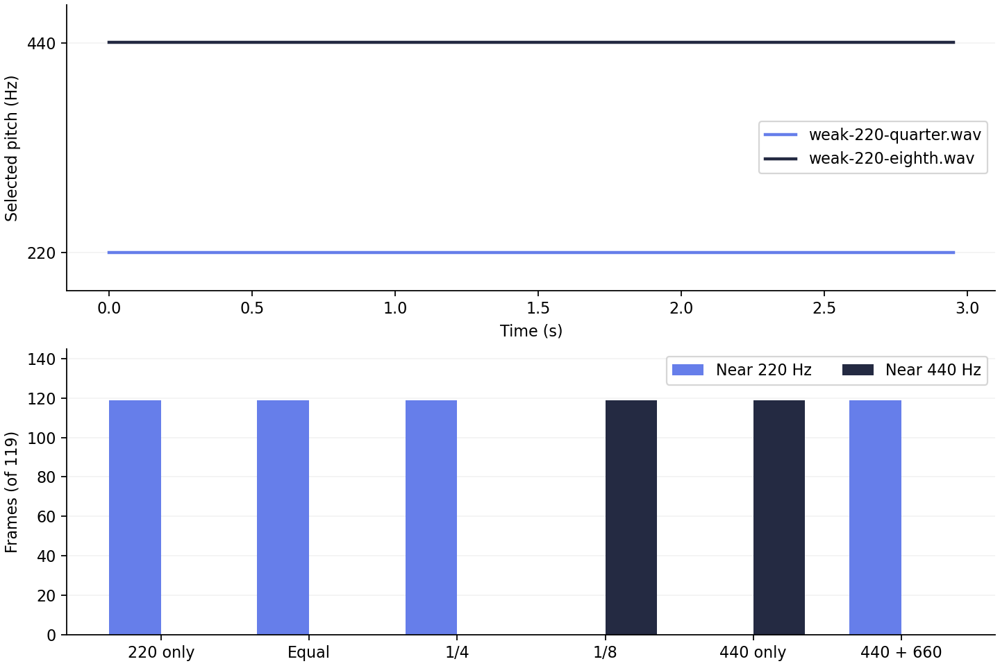

An **octave error in pitch detection** happens when a detector reads a sound one octave too high or too low. If you sing at 220 Hz and the display shows 440 Hz, did you sing the wrong note, or did the detector latch onto a harmonic? We used synthetic WAV files to explore that distinction.

[Vocal Pitch Monitor](/vocal-pitch-monitor/) looks at how often a waveform repeats, finds possible pitches, and plots them over time. It cannot identify the singer or know which note you meant to sing. Before changing your voice to follow a line that appears an octave too high, it helps to check the sound itself and the other pitch candidates.

For this experiment, we compared files with different proportions of 220 Hz and 440 Hz, a control containing only 440 Hz, and a mix of harmonics with no fundamental. The WAVs and raw analysis data are available below so you can repeat the calculations. The numbers come from **running the repository's detection function separately**, rather than measuring the browser display.

## An octave error is much bigger than a few cents

With A4 tuned to 440 Hz, A3 is 220 Hz. Both notes are called A, but A4 sits one octave above A3. Going up an octave doubles the frequency; going down halves it.

To express a pitch difference in cents, use `1200 × log2(detected frequency / reference frequency)`. Relative to 220 Hz, 440 Hz is exactly +1,200 cents. By comparison, the roughly 220.183 Hz measured in this experiment is only +1.44 cents from 220 Hz. The roughly 440.367 Hz result is also +1.44 cents from its own 440 Hz reference. A small numerical offset and an octave error are very different in size. See [Cent (music)](https://en.wikipedia.org/wiki/Cent_(music)) for the definition and calculation.

This detection function compares the waveform at shifts of whole samples. In a 48,000 Hz file, a shift of 218 samples gives `48000 / 218 ≈ 220.183`, while 109 samples gives `48000 / 109 ≈ 440.367`. That sample resolution is one reason a reading may not land exactly on 220.000 Hz.

Think of holding a note in a pop ballad. A line that wavers slightly around the note is different from one that jumps to the same note name in the next octave. The second case is a reason to check for an octave error. You might also have sung an octave higher, though, so the graph alone cannot settle the question.

## The loudest harmonic is not always the pitch

A periodic sound with a 220 Hz fundamental can also contain components at integer multiples of that frequency, such as 440 Hz and 660 Hz. These are the second and third harmonics. Even when the 440 Hz component is stronger than the fundamental, the full waveform can still repeat at the interval corresponding to 220 Hz.

[Vocal Spectrum](/audio-spectrum-analyzer/) shows how much energy is present in different frequency bands. Vocal Pitch Monitor's pitch line, on the other hand, shows a candidate chosen from the waveform's repetition intervals. A spectrum peak at 440 Hz does not necessarily mean the pitch line should read 440 Hz. The file with a 1/4 amplitude ratio in this experiment demonstrates that difference.

The current pitch detector uses **autocorrelation**. It shifts the waveform a little at a time, multiplies the overlapping samples by the original samples, and adds the products to find shifts that line up well. [Autocorrelation](https://en.wikipedia.org/wiki/Autocorrelation) explains the calculation. Sometimes a short shift lines up well, while a longer shift matches the full period. The detector has to choose between them.

This implementation does not divide the correlation value by the number of overlapping samples. Longer shifts leave fewer samples to multiply and add, which can favor shorter shifts. As the 220 Hz component weakens and the 440 Hz component becomes dominant, the half-period shift of about 109 samples can score higher than the full-period shift of about 218 samples. A strong harmonic does not automatically cause an error; the choice depends on both the waveform and this particular calculation.

## The test setup: match the peaks, vary the harmonics

All six files are synthetic **3-second, 48 kHz, 16-bit PCM, mono WAVs**. We added no noise or accompaniment. Every component starts at zero phase, and each file has a 20 ms fade at the beginning and end. We matched the maximum sample amplitude in the steady portion to about −6.02 dBFS so that weakening the fundamental would not simply make the whole file quieter. This is a sample peak measurement, not RMS or the loudness you hear in a room.

The synthesis formula is `a × sin(2π × 220t) + b × sin(2π × 440t) + c × sin(2π × 660t)`. The ratios in the table below are the components' amplitude coefficients before adjusting the overall file level. A ratio of 1/4 refers to amplitude, not energy.

For detection, we extracted the `analyze_multiple_frequencies` function directly from this repository's `src/main.rs`. We kept its Rust 32-bit floating-point calculations instead of substituting an approximate detector. The analysis reads the generated WAVs back from disk, so it also includes 16-bit rounding.

The analysis uses **2,048-sample windows**, matching the upload path, with a hop of **1,200 samples, or 25 ms**. Each window covers about 42.67 ms. A 3-second file produces 119 windows, not 120, because the remaining samples at the end are not added as another window. We used the desktop upload thresholds: an RMS floor of 0.00008 and a relative correlation peak floor of 0.12.

Each window retains up to three candidates with the strongest correlation values. To compare which pitch would be displayed, we used the settings **Pitch gate 50%, Low A0–High C8**. Among candidates within that range and with a relative correlation value of at least 0.54, we selected the strongest as the main pitch. This reproduces the graph code's selection rule separately; it does not run the actual browser decoder or canvas.

## Six files, two outcomes: A3 at 1/4, A4 at 1/8

The counts below show how many of the 119 analysis windows had a selected main pitch within ±50 cents of each reference. They are window counts, not percentage scores or singing grades. Every selected pitch in these files was approximately 220.183 Hz or 440.367 Hz.

| File | Amplitude at 220 : 440 : 660 Hz | Near 220 Hz | Near 440 Hz | What happened |
|---|---|---:|---:|---|
| 220 Hz only | 1 : 0 : 0 | 119 | 0 | A3 reference file |
| Equal fundamental and second harmonic | 1 : 1 : 0 | 119 | 0 | Stayed on A3 |
| Fundamental at 1/4 of the second harmonic | 0.25 : 1 : 0 | 119 | 0 | Stayed on A3 despite the stronger 440 Hz component |
| Fundamental at 1/8 of the second harmonic | 0.125 : 1 : 0 | 0 | 119 | Selected A4 even though the full period corresponds to A3 |
| 440 Hz only | 0 : 1 : 0 | 0 | 119 | Control file with a true A4 |
| 440 Hz and 660 Hz, no fundamental | 0 : 1 : 0.35 | 119 | 0 | Selected A3 from the harmonics' shared period |

<!-- Image: measured plots of selected frequency over time and window counts per file, drawn from the raw analysis data. This is not an app screenshot. -->
<p class="mb-blog-image">
  
</p>

<p align="center">
  <em>Top: the 1/4 file was read at about 220 Hz, and the 1/8 file at about 440 Hz. Bottom: counts from 119 windows analyzed under the same conditions. These plots show results from running the detection code, not screenshots of the browser app.</em>
</p>

Both the 1/4 and 1/8 files contain a 220 Hz component. In the 1/8 file, however, the 440 Hz candidate had a higher correlation value, so the detector chose the octave above. The result changed between these two conditions, but **1/8 is not a universal threshold for octave errors**. We did not test closely spaced ratios between them. Different phases, window lengths, or additional harmonics could also move the point where the result changes.

The file containing only 440 Hz is not an error case. It is an A4 sound read as A4. Treating 220 Hz as the correct answer for every row would misinterpret this control.

The last file checks the other side of the problem. There is no 220 Hz component, yet the combined 440 Hz and 660 Hz waveform has a shared repetition period corresponding to 220 Hz. The [missing fundamental](https://en.wikipedia.org/wiki/Missing_fundamental) phenomenon describes how pitch can be perceived through the relationships between harmonics even when the fundamental component is absent. This was not a listening study, though. We only confirmed that the detector selected a 220 Hz candidate.

## Download the WAVs and compare them yourself

Start with the two ratio files, then listen to the 440 Hz control as well. Synthetic tones can sound louder than ordinary vocal recordings, so begin at a low playback volume.

<p>
<a href="/blog/assets/vocal_pitch_monitor/octave-errors/pure-220.wav" download="pure-220.wav">220 Hz reference WAV</a> ·
<a href="/blog/assets/vocal_pitch_monitor/octave-errors/equal-220-440.wav" download="equal-220-440.wav">1:1 WAV</a> ·
<a href="/blog/assets/vocal_pitch_monitor/octave-errors/weak-220-quarter.wav" download="weak-220-quarter.wav">1/4 WAV</a> ·
<a href="/blog/assets/vocal_pitch_monitor/octave-errors/weak-220-eighth.wav" download="weak-220-eighth.wav">1/8 WAV</a> ·
<a href="/blog/assets/vocal_pitch_monitor/octave-errors/pure-440-control.wav" download="pure-440-control.wav">440 Hz control WAV</a> ·
<a href="/blog/assets/vocal_pitch_monitor/octave-errors/missing-220-with-660.wav" download="missing-220-with-660.wav">Missing fundamental WAV</a>
</p>

The [raw analysis JSON](/blog/assets/vocal_pitch_monitor/octave-errors/results.json) records each window's time, up to three candidates, and their relative correlation values. It also includes file hashes, the compiler version, and a hash of the detection function. Candidate strength here is a ratio of autocorrelation values. It is neither a harmonic amplitude measured from the spectrum nor a probability that the pitch is correct.

To repeat the calculation, download the [detection function and runner](/blog/assets/vocal_pitch_monitor/octave-errors/detector-reproduction.rs) into the same folder as the WAVs. With Rust installed, run these commands to print the candidates for each window:

```bash
rustc -O -A warnings detector-reproduction.rs -o octave-detector
./octave-detector weak-220-eighth.wav
```

Each output row starts with the starting sample number, followed by the first candidate's frequency in Hz and relative correlation value, then the frequencies and correlation values of the remaining candidates. The runner supports the supplied mono PCM16 WAVs with 44-byte headers; it is not a general-purpose audio file reader.

To regenerate all the files and plots, run `python3 scripts/make_octave_error_wavs.py` from the repository root. You will need Python, NumPy, Matplotlib, and rustc. The script extracts the detection function from the current checkout, so changes to that code may produce different results. Check the function hash and analysis settings in the JSON when comparing runs.

## Trying this in MusicalBoard

In Vocal Pitch Monitor, load the 1/4 WAV with **Upload audio** and set **Pitch gate 50%, Low A0, High C8**. Then load the 1/8 WAV and compare it with the same settings. Uploaded files are analyzed in your browser. For this comparison, loading the files directly avoids adding the effects of your speakers, room, and microphone.

Turn on **Other pitches** for the 1/8 file and look for a retained candidate near 220 Hz. These dots are not separate vocal parts or a list of individual harmonics. They are different repetition intervals found in the same waveform. Even the pure 440 Hz control can produce a 220 Hz candidate because it also repeats over longer intervals. Seeing a lower candidate does not prove that the actual note is A3.

Next, narrow the Low–High range around A3. Once the 440 Hz candidate falls outside the range, a retained 220 Hz candidate may become the main line. That changes **which candidate the display selects**. It does not correct the file's pitch or prove that you have found the original note. Try the same adjustment with the 440 Hz control to see how a range setting can steer the display toward an answer you expect. If no candidate remains in range, the line may be blank.

Increasing Pitch gate can reveal weaker candidates. But if both candidates already pass the gate and 440 Hz has the stronger correlation, A3 will not automatically become the main line. The difference between upload analysis and display settings is covered in the [Pitch gate reanalysis comparison](/blog/2026-10-20-upload-pitch-gate-reanalysis-test/). An octave jump also needs a different check from [gaps in the pitch line caused by quiet audio](/blog/2026-10-28-quiet-pitch-detection-level-ladder-test/).

For singing practice, play A3 and A4 on the [Virtual Piano](/virtual-piano/), check the octave you intend to sing, and record a short phrase. In a choir recording or a full song with accompaniment, repeating patterns from other instruments can affect the candidates. Use a voice-only recording when possible. If a passage is hard to judge, listen back or compare it with a teacher. This synthetic test does not support a vocal prescription such as changing your vowel or register to guarantee that octave errors disappear.

## What this tells us about real voices

These files contain no breath noise, consonants, vibrato, room reflections, or overlapping voices. Their sine-wave phases and harmonic ratios stay fixed, and there is no clipping. The table therefore cannot tell us how often octave errors occur with a particular singing technique, singer, or microphone.

We tested a native run of the current code and a separate reproduction of the display selection rules. If a browser's audio decoder resamples a file, the sample intervals and the duration of each analysis window can change. The live microphone path also involves device and browser processing, along with sensitivity settings that differ from the upload path. If the app shows something different from the table, record the file, browser, sample rate, Pitch gate, and Low–High settings so you can compare the conditions.

In these tests, changing the balance between the fundamental and second harmonic moved the selected pitch from 220 Hz to 440 Hz even though the files had matching sample peaks. A different harmonic mix produced a 220 Hz reading with no 220 Hz component at all. If the line jumps an octave while you practice, listen to the recording, compare it with a reference note, and check the range and other candidates. Those checks give you a better basis for deciding whether to adjust your singing or leave that passage's pitch reading unresolved.
