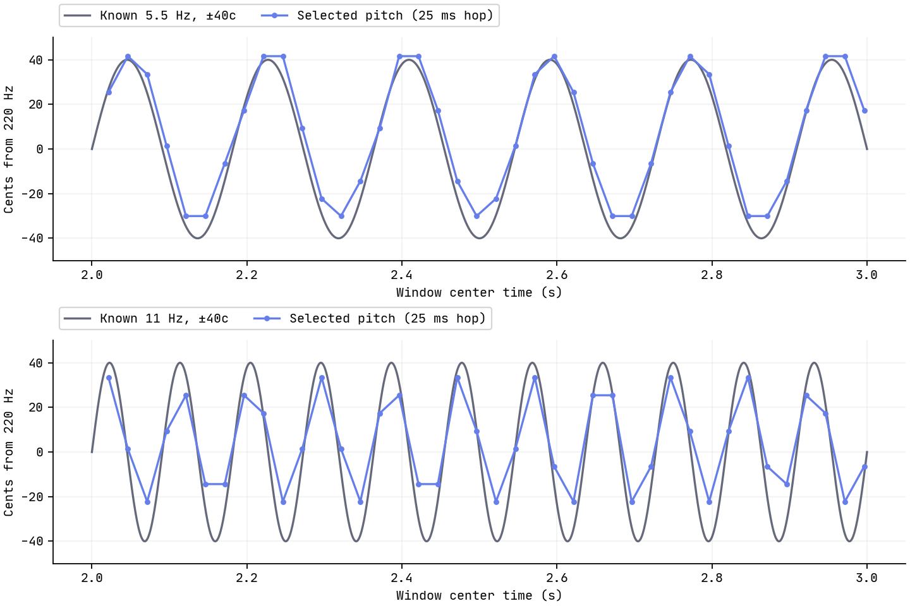

**Vibrato rate and extent** describe how fast a pitch moves and how far it moves. A familiar wave on a pitch graph can show one more faithfully than the other.

We made a tone with a known 5.5 Hz oscillation and a ±40-cent amplitude, then ran it through the detection code used by [Vocal Pitch Monitor](/vocal-pitch-monitor/). The fitted rate was 5.505 Hz, close to the input. The fitted amplitude was 37.71 cents, and its center sat 6.08 cents above the reference. A faster version lost noticeably more width.

The monitor draws pitch candidates over time; it does not give you an automatic vibrato measurement or judge vocal technique. The measurements below come from a separate native run of the repository's Rust detector and an analysis of its selected candidates. They are not readings taken from the browser canvas. The files let you check what the detector does before interpreting a similar pattern in your own singing.

## What 5.5 Hz and ±40 cents actually mean

A vibrato rate of 5.5 Hz means 5.5 complete pitch cycles each second. Each cycle lasts about 182 ms. That is unrelated to the tone's 220 Hz center frequency: one describes the slow pitch movement, the other the underlying note.

Extent needs a definition. Here, **±40 cents is a one-sided amplitude**: 40 cents below the center at the trough and 40 above it at the crest. The full peak-to-peak extent is 80 cents. Calling both quantities “40-cent vibrato” would make comparisons confusing.

Cents measure a frequency ratio. Our instantaneous frequency is:

`f(t) = 220 × 2^(40 × sin(2π × 5.5 × t) / 1200)`

It moves from about 214.975 to 225.142 Hz. Those endpoints are symmetric in cents, although their distances from 220 Hz are slightly different in Hz. The [cent definition](/blog/2026-05-12-what-is-pitch-in-music/) helps when reading a musical pitch axis; [Cent (music)](https://en.wikipedia.org/wiki/Cent_(music)) gives the frequency-ratio calculation.

This test changes frequency while keeping the tone's amplitude steady outside the fades. It therefore isolates pitch movement from loudness movement. [Vibrato](https://en.wikipedia.org/wiki/Vibrato) and tremolo are often discussed together, but loudness pulses alone do not demonstrate a pitch oscillation.

## Four files with known movement

Each file is a six-second, 48 kHz, mono, 16-bit PCM WAV with 20 ms fades at both ends and a sample peak near −6.02 dBFS. There is no accompaniment, noise, or added harmonic series. The generator integrates instantaneous frequency to get oscillator phase. Simply putting a changing frequency into `sin(2π × f(t) × t)` would create a different modulation.

We used the repository's `analyze_multiple_frequencies` function unchanged, preserving its Rust 32-bit floating-point arithmetic. It analyzed the samples read back from the WAV, including 16-bit rounding. Windows contain 2,048 samples, or 42.67 ms, and start 1,200 samples apart, or every 25 ms. Each file produces 239 complete windows.

The RMS floor was 0.00008 and the relative correlation peak threshold was 0.12. For the main pitch, we reproduced the display selection at **Pitch gate 50%, Low A0, High C8**: choose the strongest retained candidate in range with relative correlation of at least 0.54.

For measurement, we assigned each window to its midpoint and used the 160 windows whose centers fall between 1 and 5 seconds. That leaves the fades and file edges out of the comparison. We converted the selected frequencies to cents relative to 220 Hz, then fitted an offset, a linear drift, and a sine/cosine pair. The rate search covered 3–13 Hz in 0.005 Hz steps. These fitted numbers describe the detector's trace; they are not a new feature in the monitor.

| Input | Known rate | Known amplitude | Fitted rate | Fitted amplitude | Fitted center offset |
|---|---:|---:|---:|---:|---:|
| Straight 220 Hz | None | 0 cents | Not fitted | Not fitted | Constant reading: +1.44 cents |
| Main vibrato test | 5.5 Hz | ±40 cents | 5.505 Hz | 37.71 cents | +6.08 cents |
| Narrow vibrato | 5.5 Hz | ±10 cents | 5.500 Hz | 8.91 cents | +1.56 cents |
| Faster vibrato | 11 Hz | ±40 cents | 11.000 Hz | 28.70 cents | +5.04 cents |

<!-- Image: known instantaneous pitch and measured detector candidates at 5.5 Hz and 11 Hz. Drawn from the supplied WAV analysis, not a browser screenshot. -->
<p class="mb-blog-image">
  
</p>

<p align="center">
  <em>Top: the 5.5 Hz input. Bottom: the 11 Hz input. Dots show candidates selected by the native detector run, placed at window centers. The faster movement keeps its rate but loses more apparent width.</em>
</p>

## Why the spacing can be right while the width is wrong

At 5.5 Hz, a cycle spans about 7.3 analysis hops. At 11 Hz, it spans only 3.6. Meanwhile, the 42.67 ms window covers about 23% of a slow cycle and 47% of a fast one. The detector works with a stretch of changing pitch, rather than an instantaneous point on the known curve.

The faster file still returned a fitted 11 Hz rate, but its amplitude fell to 28.70 cents—about 72% of the known 40 cents. The slower file retained about 94%. Recovering the spacing between cycles therefore does not establish that the displayed width is accurate. Nor does the 25 ms hop guarantee faithful measurement of every movement below 20 Hz; window length and the detection method matter too.

The detector also chooses whole-sample repetition intervals. The straight tone consistently selected 218 samples: `48000 / 218 ≈ 220.183 Hz`, or +1.44 cents. Near this pitch, moving by one sample changes the reading by roughly eight cents. The narrow ±10-cent file used only three intervals in the fitted section: 217, 218, and 219 samples. A small staircase in such a trace need not be a staircase in the input.

The +6.08-cent center offset in the main test is another useful warning. This autocorrelation implementation scores overlapping samples without dividing by their count. Windowed pitch movement and candidate selection can affect the apparent center as well as the width. The experiment records that bias; it does not isolate a single cause for every cent of it.

Also distinguish a fitted extent from the distance between the most extreme dots. In the main test, the selected readings ranged from −30.03 to +49.76 cents. Their span was 79.79 cents, close to the known 80, yet the sine fit gave a 75.41-cent peak-to-peak extent around an offset center. A handful of extrema can make the width look right while hiding the shape and bias of the rest of the trace.

## Download and repeat the comparison

Start playback quietly: these are sustained synthetic tones, not vocal recordings.

<p>
<a href="/blog/assets/vocal_pitch_monitor/known-vibrato/straight-220.wav" download="straight-220.wav">Straight 220 Hz WAV</a> ·
<a href="/blog/assets/vocal_pitch_monitor/known-vibrato/vibrato-5p5hz-40c.wav" download="vibrato-5p5hz-40c.wav">5.5 Hz, ±40-cent WAV</a> ·
<a href="/blog/assets/vocal_pitch_monitor/known-vibrato/vibrato-5p5hz-10c.wav" download="vibrato-5p5hz-10c.wav">5.5 Hz, ±10-cent WAV</a> ·
<a href="/blog/assets/vocal_pitch_monitor/known-vibrato/vibrato-11hz-40c.wav" download="vibrato-11hz-40c.wav">11 Hz, ±40-cent WAV</a>
</p>

The [raw results JSON](/blog/assets/vocal_pitch_monitor/known-vibrato/results.json) includes every window's candidates, the selected pitch, start and center times, fitted results, file hashes, and the detector hash. Its candidate strengths are relative autocorrelation values, not probabilities that a pitch is correct.

Download the [standalone Rust runner](/blog/assets/vocal_pitch_monitor/known-vibrato/detector-reproduction.rs) beside the WAVs and run:

```bash
rustc --edition=2021 -O -A warnings detector-reproduction.rs -o vibrato-detector
./vibrato-detector vibrato-5p5hz-40c.wav
```

It prints each window's starting sample, then the candidates' frequencies and correlation values. It supports the supplied 44-byte-header mono PCM16 WAVs at 48 kHz. To regenerate this experiment's vibrato fixtures in a checkout, run `python3 scripts/make_vibrato_retune_fixtures.py`. That script needs NumPy, Matplotlib, Rust, Cargo, and rustfft. It extracts the current DSP code, so compare source hashes when repeating it after code changes.

## Reading your own vibrato in MusicalBoard

Upload the main test directly into [Vocal Pitch Monitor](/vocal-pitch-monitor/) and use **Pitch gate 50%, Low A0, High C8**. Compare the straight and narrow files before the faster one. A broad range is useful for spotting unexpected octave choices; afterward, zoom around A3 to inspect the wave. Narrowing the display does not improve the detector's frequency resolution.

For a singing exercise, record a comfortable held note in a short ballad phrase. Listen back, then inspect the settled part rather than the attack or release. Look first at cycle spacing, then at center and width. Compare recordings with the same setup and settings. These synthetic values are a reference for the measurement method, not a prescribed vibrato for your voice.

If the whole line jumps an octave, check the [220-to-440 Hz octave-error experiment](/blog/2026-11-11-pitch-detection-octave-error-220-440/) before measuring vibrato. If the line has gaps, the [quiet-input test](/blog/2026-10-28-quiet-pitch-detection-level-ladder-test/) addresses a different problem. Missing or wrongly selected candidates can distort any rate or width estimate.

## What carries over to a real voice

The files have regular modulation, one sinusoidal oscillator, and fixed level. Real recordings add harmonics, changing vowels, consonants, breath, room reflections, and sometimes accompaniment. A voice can also drift while its vibrato rate changes. A single sinusoidal fit may then be a poor description.

Browser resampling and live microphone processing can change the conditions further. The midpoint timestamps used here are an analysis convention, not a claim about the canvas's timing or microphone latency. If a browser result differs, note its sample rate, input method, gate, and range before comparing it with the JSON.

For these four files, cycle rate survived better than amplitude, and a plausible-looking width did not guarantee a correct center. That is a useful habit to bring to practice: treat the wave as something to describe and listen to, then decide whether it reflects a musical choice you want to change.
