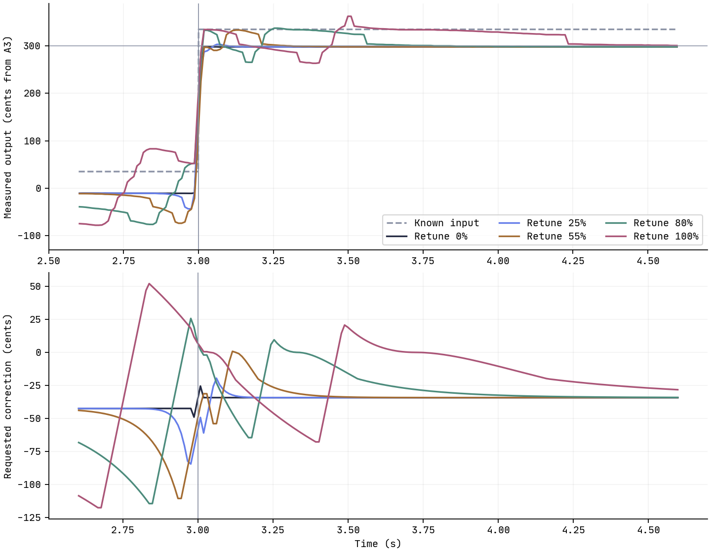

**Auto-Tune retune speed** affects how pitch movement is corrected. A three-semitone jump shows why the slider cannot be read as a delay in milliseconds.

We made a tone that jumps from A3 to C4, with both notes 35 cents sharp, and processed it at five Retune speed settings. With Strength at 100% and Tolerance at 0 cents, the measured output settled within ±10 cents of C4 after about 19 ms at Retune 0%, 211 ms at 55%, and 1,235 ms at 100%. At slower settings, the correction also changed before the jump.

[Auto-Tune](/auto-tune/) works on a loaded recording and chooses targets from a scale. It does not know the melody you intended, and the Retune speed percentage is not a live monitoring latency setting. These results come from a native reproduction of the current Rust DSP pipeline, including pitch detection and audio resynthesis. We measured the generated WAVs; we did not measure the browser interface or its processing time.

## Why a pitch jump alone is not enough

A3 is 220 Hz and C4 is about 261.626 Hz. Their ratio is `2^(3/12)`, making the interval three semitones, or 300 cents.

If both notes already belong to the selected scale, a jump does not inherently require correction. To give the processor a clear tuning error on both sides, the main file adds 35 cents to each note. Its pitch is therefore +35 cents relative to A3 before the jump and +335 cents afterward. The desired note centers are 0 and +300 cents on that same axis.

That separates two quantities: **the melody moves by 300 cents, while the steady tuning error is 35 cents**. A table calling the measured settling time “time to shift by three semitones” would confuse them.

We also included a control that jumps between exact A3 and C4. It checks whether a slow setting can affect a transition even when the sustained input notes are already correct. It can, as the results below show. The earlier [35-cent sustained-tone experiment](/blog/2026-10-17-auto-tune-synthetic-tone-before-after/) asks what happens to a steady offset; this test asks what happens around a note change.

## The files and processing conditions

Both inputs are six-second, 48 kHz, mono, 16-bit PCM WAVs. The pitch changes at exactly 3.000 seconds. Oscillator phase stays continuous across the change; there is no silence or amplitude envelope reset there. Each file has 20 ms fades at its outer edges and a sample peak near −6.02 dBFS. There is no noise, accompaniment, or vibrato.

For every main comparison, we used **Key A, Scale Natural Minor, Strength 100%, Tolerance 0 cents**. Only Retune speed changed: 0%, 25%, 55%, 80%, and 100%. A natural minor contains A, B, and C, so an intermediate pitch candidate can select B while the smoothed center crosses between A and C. The target is determined by the algorithm, not a supplied two-note score.

The runner extracts the DSP helpers and target-building block from `src/tools/auto_tune.rs`. It makes the YIN and TD-PSOLA helpers synchronous and removes browser progress, cancellation, and scheduling hooks. The pitch calculations and synthesis operations remain those of the checkout. Browser audio decoding is replaced by reading the supplied PCM WAV.

At 48 kHz, the analysis path downsamples by four to 12 kHz. YIN uses 512 analysis samples per window and a 128-sample hop: 42.67 ms windows spaced 10.67 ms apart. The pipeline repairs octave outliers, applies a narrow median filter, builds the target contour, and resynthesizes the audio with TD-PSOLA. We then encode PCM16 and run the same cleaned YIN analysis on that downloadable output. The table describes **pitch measured from the corrected audio**, rather than just the requested target curve.

The [YIN paper](https://doi.org/10.1121/1.1458024) describes the estimator family; [PSOLA](https://en.wikipedia.org/wiki/PSOLA) explains the pitch-synchronous overlap-add approach. Neither source guarantees these particular results for another implementation.

## What the Retune speed percentage controls

In this implementation, 0% disables smoothing of the pitch center. Higher percentages make that center smoother over a longer interval. The mapping for nonzero settings is:

`time constant in ms = 10 × 50^(Retune speed / 100)`

The corresponding smoothing coefficient depends on the analysis hop. A 100% setting gives a 500 ms time constant; 55% gives about 86 ms. These are internal filter parameters, not promises that an output note will arrive after exactly that many milliseconds. [Exponential smoothing](https://en.wikipedia.org/wiki/Exponential_smoothing) provides background on how such coefficients work.

The processor smooths forward and backward over each voiced segment. It corrects that slow center toward a held scale note, then adds back the difference between the detected pitch and the smoothed center. That difference contains vibrato and short ornaments, but it can also contain part of an abrupt note change.

A held scale note changes only when another note becomes closer by more than the 40-cent hold margin. After building the targets, the pipeline also limits changes in the requested correction to 1,100 cents per second. This limit applies even at Retune 0%. An instantaneous center snap therefore does not guarantee an instantaneous, perfectly measured audio transition.

## Measured settling times for the 35-cent-sharp jump

We call the output **settled** at the first frame after the jump for which that frame and every remaining frame through 5.5 seconds are voiced and within ±10 cents of C4. A brief crossing into the band does not qualify. The last column uses the plateau from 4.5 to 5.5 seconds.

| Retune speed | Internal time constant | Measured settling time after the jump | Median late error from C4 |
|---|---:|---:|---:|
| 0% | Smoothing disabled | 19 ms | −1.94 cents |
| 25% | 26.6 ms | 40 ms | −1.94 cents |
| 55% | 86.0 ms | 211 ms | −1.93 cents |
| 80% | 228.7 ms | 563 ms | −1.93 cents |
| 100% | 500.0 ms | 1,235 ms | −0.47 cents |

Times are rounded from a 10.67 ms analysis grid. They include the behavior of pitch estimation, target selection, synthesis, and output measurement. They are not estimates of playback delay, Apply-button processing duration, or a universal response time for singing.

<!-- Image: measured corrected-audio pitch and the requested correction around the synthetic A3-to-C4 jump. Native DSP experiment, not an Auto-Tune roadmap screenshot. -->
<p class="mb-blog-image">
  
</p>

<p align="center">
  <em>Top: pitch measured from the corrected WAVs; the dashed line is the known input and the horizontal reference at 300 cents is C4. Bottom: correction requested by the target contour. The vertical line marks the input jump at 3 seconds.</em>
</p>

## Why slower correction can change the preceding note

The slow curves do not simply trace a smooth climb to C4. They bend, briefly land elsewhere, and can move before 3 seconds. Forward/backward smoothing uses samples from both sides of the transition when estimating the center. That is possible in an offline recording processor, but it makes a simple causal delay model misleading.

The residual pitch movement is added back around the selected scale note. As the smoothed center passes intermediate scale targets, the held note can change, causing another adjustment. The correction slew limit spreads those adjustments over subsequent frames. Together, these operations explain why the output can overshoot or dip before finally settling.

In the exact-note control, Retune 0% settled after about 19 ms, while 100% settled after about 1,192 ms. The latter also changed the pitch before the jump despite both input plateaus being on scale notes. A slow setting is therefore not a guarantee that every already-correct transition stays untouched. This does not show that sustained correct notes always move; it shows what happened around this continuous, abrupt transition under these settings.

The main test used maximum Strength and zero Tolerance to expose the behavior. It does not establish the same settling times for Gentle, Natural, or Moderate presets, which change several settings together.

## Listen to the same transition at five speeds

Begin at a low volume. Compare a short section spanning both sides of the three-second mark, then listen to the late C4 plateau.

<p>
<a href="/blog/assets/auto_tune/retune-step/step-a3-c4-plus35c.wav" download="step-a3-c4-plus35c.wav">Original, 35 cents sharp</a> ·
<a href="/blog/assets/auto_tune/retune-step/step-a3-c4-plus35c-retune-0.wav" download="step-a3-c4-plus35c-retune-0.wav">Retune 0%</a> ·
<a href="/blog/assets/auto_tune/retune-step/step-a3-c4-plus35c-retune-25.wav" download="step-a3-c4-plus35c-retune-25.wav">Retune 25%</a> ·
<a href="/blog/assets/auto_tune/retune-step/step-a3-c4-plus35c-retune-55.wav" download="step-a3-c4-plus35c-retune-55.wav">Retune 55%</a> ·
<a href="/blog/assets/auto_tune/retune-step/step-a3-c4-plus35c-retune-80.wav" download="step-a3-c4-plus35c-retune-80.wav">Retune 80%</a> ·
<a href="/blog/assets/auto_tune/retune-step/step-a3-c4-plus35c-retune-100.wav" download="step-a3-c4-plus35c-retune-100.wav">Retune 100%</a>
</p>

<p>
<a href="/blog/assets/auto_tune/retune-step/step-a3-c4-on-note.wav" download="step-a3-c4-on-note.wav">Exact-note control</a> ·
<a href="/blog/assets/auto_tune/retune-step/step-a3-c4-on-note-retune-0.wav" download="step-a3-c4-on-note-retune-0.wav">Control at 0%</a> ·
<a href="/blog/assets/auto_tune/retune-step/step-a3-c4-on-note-retune-100.wav" download="step-a3-c4-on-note-retune-100.wav">Control at 100%</a>
</p>

The [results JSON](/blog/assets/auto_tune/retune-step/results.json) records source pitches, smoothed centers, requested targets, measured output pitches, settings, metrics, and hashes. To repeat one correction without the browser, save the [native runner](/blog/assets/auto_tune/retune-step/native-reproduction.rs), [Cargo.toml](/blog/assets/auto_tune/retune-step/Cargo.toml), and [Cargo.lock](/blog/assets/auto_tune/retune-step/Cargo.lock) beside the input WAV. With Rust and Cargo installed, run:

```bash
cargo run --release --locked -- step-a3-c4-plus35c.wav 55 repeated-retune-55.wav
```

The runner prints frame time, source Hz, smoothed-center MIDI, target Hz, and measured output Hz. It supports these 48 kHz mono PCM16 files with 44-byte headers. To regenerate both experiments and plots from a checkout, use `python3 scripts/make_vibrato_retune_fixtures.py`; NumPy and Matplotlib are also required. Source and runner hashes identify the DSP version tested here.

## Choosing a setting for a real phrase

Load the sharp input into [Auto-Tune](/auto-tune/), set A Natural Minor, Strength 100%, and Tolerance 0, and compare 0%, 55%, and 100%. Use **Apply Again** to process the original at each setting. The roadmap measures the corrected audio, so compare it with both the requested contour in the JSON and what you hear.

For your own pop phrase, keep Strength and Tolerance fixed while changing Retune speed. Listen around the approach to a note, not only its middle. A slower setting may preserve a useful scoop or vibrato, but it can also disturb a short transition. A faster setting may suit one phrase and remove an ornament you wanted in another.

The [known-vibrato experiment](/blog/2026-11-15-known-vibrato-rate-extent-test/) helps distinguish pitch-trace measurement errors from actual movement. For practice feedback, listen to the original recording as well as the corrected one: a changed curve does not by itself diagnose a singing problem.

## Where this experiment stops

A continuous sine wave with an abrupt jump is a controlled stress test. It has no consonant boundary, breath, changing harmonics, or expressive timing. A gap between notes would divide the voiced segments and could change the smoothing behavior. We tested one upward interval, one key and scale, and one level; downward jumps, other intervals, and other settings need their own measurements.

Browser decoding may also resample the file, and this native run excludes browser scheduling and playback. The late error of a few cents includes synthesis and pitch-estimator behavior, so it should not be treated as an audible quality grade.

What the comparison gives you is a concrete reason to audition transitions. In this implementation, moving Retune speed upward extends the smoothing interval and changes how short movement is retained. The result can include changes before the note boundary and a longer settling period afterward. Keep the same phrase and the other sliders fixed, compare both sides of the change, and choose by the recording you hear.
