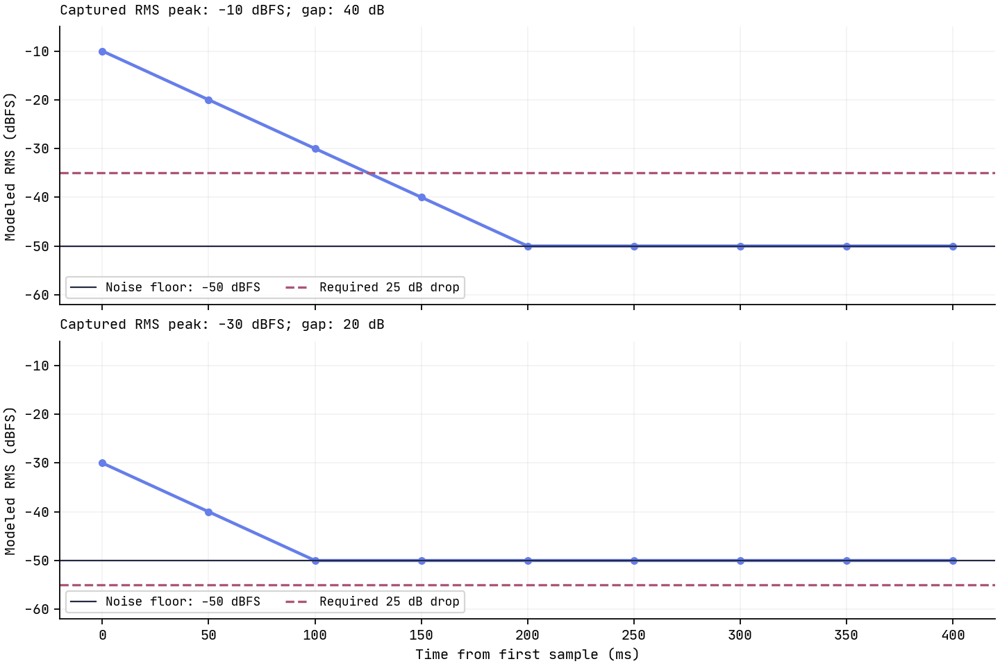
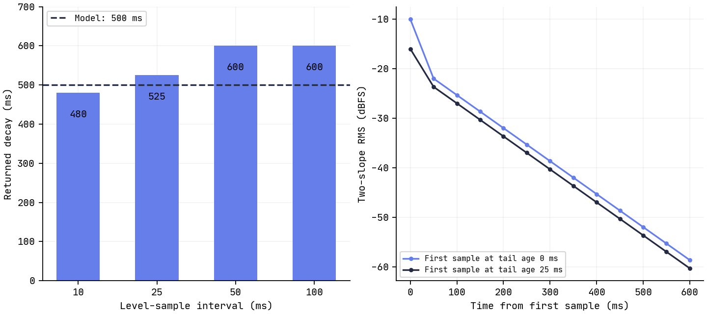

A **quiet room can still fail a clap test** if the captured clap is too weak to reveal enough decay above the background noise. A long number can reflect that missing measurement range.

[Mic Room Diagnostics](/mic-room-diagnostics/) checks background noise first, then estimates room ring from a handclap. Those checks answer different questions. In the simulation below, a steady −50 dBFS background passed the noise-level threshold. With a strong recorded clap, the decay routine returned 300 ms. With a weaker clap over exactly the same background, it returned its maximum: 8,000 ms.

We reproduced that calculation using the repository's unchanged Rust function and synthetic RMS-level curves. These are **simulations of the estimator**, not measurements of a room or the browser interface. Downloadable curves, code, and listening examples accompany the results so you can separate a weak measurement from a genuinely long sound tail.

## Quiet background and a clear decay are different requirements

The noise-level part of Step 1 passes at **−45 dBFS or lower**. More negative means quieter relative to digital full scale; it does not tell you the sound pressure level in the room. [dBFS](https://en.wikipedia.org/wiki/DBFS) describes that digital reference.

Step 2 instead needs a useful gap between its captured clap RMS peak and the background. The current routine finds the highest recorded level, then looks for the first samples at least 5 dB and 25 dB below it. It returns:

`estimated decay = 3 × (time at −25 dB − time at −5 dB)`

For a straight decay in dB, that 20 dB span can be extrapolated to 60 dB. A floor only 20 dB below the captured peak prevents the second crossing. Being quiet enough to pass Step 1 does not ensure that the clap sits far enough above that floor.

There are also two different “peaks.” Clap detection watches for an individual sample whose absolute amplitude exceeds 0.15, about −16.5 dBFS. The decay routine subsequently uses **RMS levels**. A short transient can clear the attack threshold while the later RMS snapshots are much weaker. Detecting a clap therefore does not prove that its recorded tail contains a clean 25 dB drop.

## Same background, 300 ms or 8,000 ms

We first modeled a component that falls 60 dB in 300 ms. Its level is a straight line in dB until it reaches a constant floor. The first captured RMS level is either −10 or −30 dBFS, and the floor is −50 dBFS in both cases.

| Modeled captured RMS peak | Background floor | Available gap | Calculation used | Returned decay |
|---|---|---:|---|---:|
| −10 dBFS | −50 dBFS | 40 dB | Both crossings found | 300 ms |
| −30 dBFS | −50 dBFS | 20 dB | Fallback extrapolation | 8,000 ms |

The stronger curve needs to reach −35 dBFS for its 25 dB crossing, comfortably above the floor. The weaker curve would need to reach −55 dBFS. It levels out at −50 instead, so that crossing never occurs.

<!-- Image: simulated RMS curves over the same −50 dBFS floor, with the required 25 dB drop marked for strong and weak captured peaks. This is not a browser screenshot or a room measurement. -->
<p class="mb-blog-image">
  
</p>

<p align="center">
  <em>Both backgrounds meet the noise-level threshold. The upper curve reaches the required 25 dB drop; the lower curve reaches the floor first. Dots are simulated level samples at 50 ms intervals.</em>
</p>

When either crossing is missing, the function estimates decay from the recorded peak to the last sample:

`fallback decay = elapsed time × 60 / observed drop in dB`

Our samples run from 0 through 2,950 ms. With only a 20 dB drop, the uncapped estimate is `2950 × 60 / 20 = 8850 ms`, then clipped to 8,000 ms. The underlying decaying component still has a 300 ms slope. The long result comes from including the flat background in an extrapolation that assumes continued decay.

The maximum is a numerical cap, not evidence of an eight-second room response. A truly reflective room can also return a long estimate, so the number alone cannot identify which explanation applies.

## Does that depend on an artificial hard floor?

A hard floor is easy to follow, but real recorded level does not usually stop at a perfect corner. We repeated the calculation by adding the decaying component's power to a stationary background power:

`combined level = 10 × log10(10^(decay level / 10) + 10^(floor level / 10))`

That models uncorrelated components in an idealized RMS calculation. With a −30 dBFS component and a −50 dBFS background, it still returned 8,000 ms. The missing-crossing problem survived the smoother approach to the floor.

A borderline case was more sensitive. A −20 dBFS component over a −45 dBFS background has only a nominal 25 dB gap. With the first sample at the component's onset, the additive-power model returned 600 ms. Starting the samples 25 ms into the same 300 ms decay reduced the captured peak enough to lose the crossing, and the result became 8,000 ms.

That bare 25 dB gap is therefore not a reliable target for this estimator. Level near the floor and missed early energy can make the reading change substantially. Lowering the recording gain alone generally lowers both the clap and background; it does not necessarily improve their ratio.

## Why sampling changes the number even in a clean model

The page requests a level snapshot every 50 ms for three seconds. Our simulation uses evenly spaced timestamps. Actual browser callbacks can arrive late, so these exact steps describe the simulation rather than guaranteed browser timing.

For a clean component falling 60 dB in 500 ms, the ideal 5 dB crossing occurs at 41.67 ms and the 25 dB crossing at 208.33 ms. At 50 ms spacing, the first recorded crossings are 50 and 250 ms. The function therefore returns `(250 − 50) × 3 = 600 ms`.

Changing only the simulated interval gave:

| Level-sample interval | Returned decay for the same 500 ms model |
|---|---:|
| 10 ms | 480 ms |
| 25 ms | 525 ms |
| 50 ms, matching the page's requested interval | 600 ms |
| 100 ms | 600 ms |

These alternatives are offline comparisons, not settings available in the tool. When both crossings use a uniform 50 ms grid, their difference is a multiple of 50 ms, and the final T20-based estimate moves in **150 ms steps**. Fallback values and irregular callback times do not follow that same rule.

We also tested a curved decay: 12 dB lost in the first 50 ms, followed by a slower slope of 60 dB per 900 ms. At 50 ms spacing, the routine returned 600 ms when the first sample captured the onset and 900 ms when it started 25 ms later. The sound model was unchanged. The measured span included different proportions of the fast and slow decay, which is why this curve has no single straight-line reference time.

<!-- Image: native estimator results at four simulated sampling intervals, plus the same two-slope decay sampled with two onset offsets. Drawn from the supplied level curves. -->
<p class="mb-blog-image">
  
</p>

<p align="center">
  <em>Left: changing the sample interval changes the returned number. Right: starting 25 ms later changes which part of a two-slope tail contributes to the estimate. These are calculation experiments, not acoustic surveys.</em>
</p>

## Download the curves and repeat the calculation

The [level-curve CSV](/blog/assets/mic_room_diagnostics/clap-decay/level-curves.csv) contains 64 cases: eight scenarios, four sample intervals, and two onset offsets per interval. Each row records a case ID, elapsed milliseconds, and RMS dBFS. The [results JSON](/blog/assets/mic_room_diagnostics/clap-decay/results.json) records the crossings, calculation branch, returned value, assumptions, compiler version, and source hashes.

We extracted `compute_rt60` directly from `src/tools/mic_diagnostics.rs` and kept its calculations unchanged. The simulation starts each recorded curve at time zero; the onset offset means how old the modeled tail is at that first sample. It does not reconstruct clap detection or the browser's first callback. It also omits PCM snapshot averaging, device processing, and timer jitter.

Download the [standalone Rust runner](/blog/assets/mic_room_diagnostics/clap-decay/decay-reproduction.rs) beside the CSV, then run:

```bash
rustc --edition=2021 -O decay-reproduction.rs -o clap-decay
./clap-decay level-curves.csv
```

The output is one case ID and returned decay per line. To regenerate the curves, WAVs, and plots in a checkout, run `python3 scripts/make_clap_decay_fixtures.py`. It requires NumPy, Matplotlib, and Rust. A [downloadable copy of the generator](/blog/assets/mic_room_diagnostics/clap-decay/make_clap_decay_fixtures.py) is also available; save it in the checkout's `scripts` directory before running it. The script extracts the current function, so check hashes when comparing later revisions.

Two WAVs illustrate a strong and weak decaying 3 kHz tone over the same steady 6 kHz background component. Each includes a separate short trigger pulse. They are deliberately synthetic listening examples; **the table was calculated from the level curves, not these WAVs**. Start at a low playback volume.

<p>
<a href="/blog/assets/mic_room_diagnostics/clap-decay/strong-tail-quiet-floor.wav" download="strong-tail-quiet-floor.wav">Strong-tail listening WAV</a> ·
<a href="/blog/assets/mic_room_diagnostics/clap-decay/weak-tail-quiet-floor.wav" download="weak-tail-quiet-floor.wav">Weak-tail listening WAV</a>
</p>

## What to do when your room passes Noise but looks Very Ringy

In [Mic Room Diagnostics](/mic-room-diagnostics/), distinguish **Retry Needed** from a long **Space Decay** value. Retry Needed follows a clap-detection timeout. In the current code, a completed capture is marked reliable even when the decay function uses its fallback. A missing 25 dB crossing does not automatically produce a retry message.

For a practice recording, use a repeatable setup: the same microphone, input gain, clap distance, and quiet background. Clap once firmly without clipping, stay still afterward, and compare several attempts. A large spread in results is a reason to question the capture before deciding that the room needs treatment. The [three-check setup guide](/blog/2026-05-30-mic-room-diagnostics-three-check-setup/) covers the rest of that workflow.

The code reads 1,024 time-domain samples per snapshot because it allocates the analyser's frequency-bin count, half its 2,048-point FFT size. At 48 kHz that covers about 21.3 ms, while polling occurs every 50 ms. A brief attack can fall awkwardly between snapshots. MDN documents how [getFloatTimeDomainData](https://developer.mozilla.org/en-US/docs/Web/API/AnalyserNode/getFloatTimeDomainData) handles an array shorter than the FFT size.

The page requests echo cancellation, noise suppression, and automatic gain control off. [MediaTrackConstraints](https://developer.mozilla.org/en-US/docs/Web/API/MediaTrackConstraints) describes those capture requests; they are not proof that every device produces an unprocessed signal. Keep the device and browser consistent when comparing runs.

Mic Room Diagnostics listens to the microphone; it does not import these fixture WAVs. Playing them through speakers and recording them again adds the speakers, room, and microphone to the signal. For the exact numerical comparison, use the supplied CSV and runner.

Finally, record a short voice-only phrase in [Singing Recorder](/singing-recorder/) and listen between words and at the ends of held notes. That gives useful evidence about the recording you actually want to make. For a measured room reverberation time, use an appropriate acoustic measurement method; [Reverberation](https://en.wikipedia.org/wiki/Reverberation) explains the broader concept. This quick clap estimate is best read alongside a repeatable capture and the recording itself.
