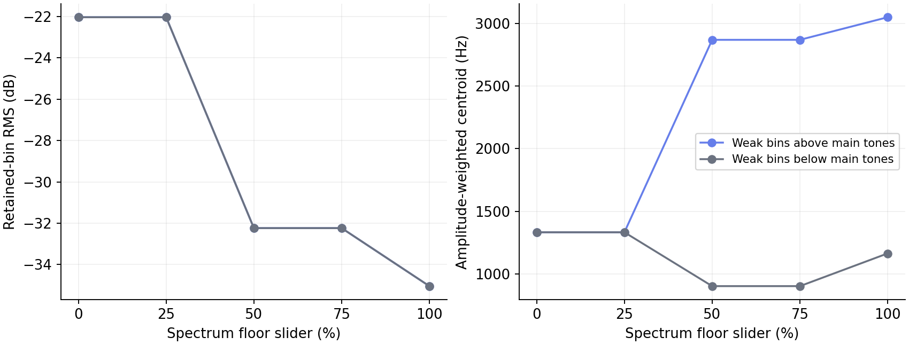

**Changing Spectrum floor can change RMS and CENTROID without changing the sound.** This experiment shows a roughly 13 dB RMS drop from the setting alone and explains how to separate display settings from changes in your recording.

[Vocal Spectrum](/audio-spectrum-analyzer/) displays frequency magnitudes and summarizes the current spectrum. Its RMS describes the magnitudes that pass the selected analysis conditions. It does not measure the loudness of an entire recording or the sound pressure in your room. CENTROID also depends on the components retained, so a higher reading after a setting change does not establish that your voice became brighter.

We compare weak components above and below the main tones using **synthetic FFT-bin inputs fed directly into the current calculation code**. These are calculation experiments, not browser measurements or evaluations of a singer. Downloadable inputs, results, code, and separate listening WAVs let you check what changed and why.

## A higher Spectrum floor percentage includes weaker components

The `Spectrum floor` slider runs from 0–100%. Higher percentages reveal weaker components: **raising the percentage lowers the actual dB threshold.** The current conversion is:

`floor (dB) = −30 − 0.45 × slider percentage`

The implementation converts the percentage to an internal floating-point value and back, introducing tiny rounding differences. The practical thresholds are:

| Spectrum floor | Inclusion threshold |
|---|---:|
| 0% | −30 dB |
| 25% | −41.25 dB |
| 50% | −52.5 dB |
| 75% | −63.75 dB |
| 100% | −75 dB |

Bins below the threshold are excluded; bins exactly at it are included. A −45 dB component therefore drops out at 25% and enters at 50%. Moving from 50% to 75% may leave the readings unchanged if no additional bins fall between those thresholds.

This setting does not remove noise from the audio. A disappearing bar does not mean that component was erased from your recording. Spectrum floor is also independent of Pitch gate in [Vocal Pitch Monitor](/vocal-pitch-monitor/). Revealing weaker spectral components and changing the conditions for displaying a pitch trace are separate operations.

## The experiment: fixed bins, changing floor

An ordinary FFT can spread one tone across neighboring frequency bins. To isolate the floor's effect, we constructed bin values directly. **These inputs were designed for the calculation function; they were not obtained by analyzing a WAV.**

The conditions were a 48 kHz sample rate, 1,024 frequency bins, Low at 80 Hz, and High at 16 kHz. That corresponds to a 2,048-point FFT with approximately 23.44 Hz spacing. The current label rule is `(bin index + 0.5) × bin spacing`. Those labels are not precise pitch estimates; the [known-harmonic spectrum experiment](/blog/2026-11-04-spectrum-harmonic-bin-alignment-test/) explains the distinction.

Both inputs contain strong bins near 996 Hz at −20 dB and 2,004 Hz at −26 dB. Their weaker components differ:

- **Weak-high input:** twenty −45 dB bins between approximately 4.70 and 5.14 kHz.
- **Weak-low input:** twenty −45 dB bins between approximately 105 and 551 Hz.
- Both inputs also contain twenty −65 dB bins around 7.04–7.49 kHz. All remaining bins are fixed at −90 dB.

The inputs have identical counts at each magnitude; only the locations of the −45 dB bins differ. Each input stays unchanged while the slider moves through 0%, 25%, 50%, 75%, and 100%. We extracted `analyze_spectrum` and the floor conversion functions unchanged from the repository, ran them in Rust, and checked the results against separate NumPy formulas.

## Weak high-frequency bins lower RMS and raise CENTROID

Here are three settings for the weak-high input, rounded for readability. The downloads include all five settings and additional decimal places.

| Spectrum floor | Threshold | Bins retained | PEAK | LEVEL | CENTROID | RMS |
|---|---:|---:|---:|---:|---:|---:|
| 0% | −30 dB | 2 | 996 Hz | −20.0 dB | 1,333 Hz | −22.04 dB |
| 50% | −52.5 dB | 22 | 996 Hz | −20.0 dB | 2,870 Hz | −32.24 dB |
| 100% | −75 dB | 42 | 996 Hz | −20.0 dB | 3,050 Hz | −35.04 dB |

At 0%, only the two strong bins remain. At 50%, the twenty −45 dB bins enter and RMS falls by about 10.20 dB. At 100%, the −65 dB bins also enter, bringing the total drop to approximately 13.01 dB. The strongest bin survives every threshold, so PEAK and LEVEL stay fixed.

Why does including more components lower RMS? The calculation converts dB to linear amplitude, sums squared amplitudes, **divides by the number of retained bins**, takes the square root, and converts back to dB:

`amplitude a = 10^(dB / 20)`

`RMS (dB) = 20 × log10(√(Σa² / retained bin count))`

Adding small values also increases the denominator—from 2 to 22 to 42 here. With a fixed spectrum and frequency band, lowering the threshold only adds values no larger than those already retained. Once a valid RMS exists, admitting those weaker bins alone cannot raise it. Raising the threshold and removing weaker bins can increase the average.

Neither “the voice got quieter” nor “removing noise made the voice louder” follows from this change. The input magnitudes never moved. The [general RMS definition](https://en.wikipedia.org/wiki/Root_mean_square) helps explain why the population being averaged matters: RMS over waveform samples and RMS over retained FFT magnitudes are different calculations.

## Weak low-frequency bins move CENTROID the other way

CENTROID averages the retained frequencies using linear amplitude as the weight:

`CENTROID (Hz) = Σ(frequency × amplitude) / Σamplitude`

Adding bins above the existing centroid can raise it; adding bins below it can lower it. The slider percentage alone does not predict the direction. For the weak-low input:

| Spectrum floor | Bins retained | CENTROID | RMS |
|---|---:|---:|---:|
| 0% | 2 | 1,333 Hz | −22.04 dB |
| 50% | 22 | 902 Hz | −32.24 dB |
| 100% | 42 | 1,164 Hz | −35.04 dB |

RMS matches the weak-high case because the counts at each magnitude are identical. CENTROID falls by about 430 Hz at 50%, then rises by approximately 261 Hz at 100% as the shared, very weak 7 kHz components enter. **Moving the slider in one direction can make CENTROID fall and then rise.**

<!-- Image: compare RMS and CENTROID at five floor settings for two fixed synthetic FFT inputs. This plot represents calculations, not a browser capture or a voice measurement. -->
<p class="mb-blog-image">
  
</p>

<p align="center">
  <em>The two RMS curves overlap on the left. On the right, the location of the −45 dB bins changes the centroid's direction; at 100%, shared −65 dB high-frequency bins enter. Dots show the five calculated settings, with lines connecting them.</em>
</p>

The [librosa spectral centroid documentation](https://librosa.org/doc/0.11.0/generated/librosa.feature.spectral_centroid.html) also describes a frequency mean weighted by spectral magnitude. When comparing programs, check whether weights use amplitude or power, how frequencies are assigned, and which bins are excluded. These tables use MusicalBoard's current amplitude-weighted definition.

## Check Low–High and missing readings too

Matching the floor is insufficient if the frequency bands differ. Lowering High from 16 kHz to 4 kHz in the weak-high case excludes every added weak component. At 0%, 50%, and 100%, two bins remain, with CENTROID at 1,333 Hz and RMS at −22.04 dB.

The unchanged readings mean that no additional eligible components entered the selected band. Cutting high frequencies from a recording with accompaniment can lower its centroid without changing the vocal performance. Excluding a kick drum or bass at the low end likewise changes what gets averaged.

We also tested an input with every bin at −90 dB. All five settings returned no valid result; the interface displays dashes. That means no bins passed the current band and floor, not that the original audio was necessarily silent. A zero in a default result structure must be interpreted alongside the validity flag.

A boundary input with one bin exactly at −30 dB was retained at 0%. In a real recording, small fluctuations can move a bin across that boundary. Check signal stability and settings before interpreting a threshold-adjacent jump as a performance change.

## Download the inputs and repeat the calculation

The supplied dataset contains 25 results covering both frequency arrangements, the changed High limit, below-floor inputs, and exact-boundary inputs at five settings. The [input CSV](/blog/assets/vocal_spectrum/floor-sweep/spectrum-inputs.csv) stores conditions and 1,024 semicolon-separated bin values per row. The [results CSV](/blog/assets/vocal_spectrum/floor-sweep/results.csv) records retained counts and the four metrics. The [results JSON](/blog/assets/vocal_spectrum/floor-sweep/results.json) includes signal conditions, source hashes, compiler version, and verification details.

Save the [standalone Rust runner](/blog/assets/vocal_spectrum/floor-sweep/floor-reproduction.rs) beside the input CSV, then run:

```bash
rustc --edition=2021 -O floor-reproduction.rs -o floor-sweep
./floor-sweep spectrum-inputs.csv
```

To regenerate the assets in a checkout, run `python3 scripts/make_spectrum_floor_fixtures.py`. It requires NumPy, Matplotlib, and Rust. A [generator copy](/blog/assets/vocal_spectrum/floor-sweep/make_spectrum_floor_fixtures.py) is available; place it in the checkout's `scripts` directory. The standalone Rust runner already contains the required functions and can run without the full application source.

The generator extracts functions from the checkout at generation time. Later code changes can produce different results; use the JSON hashes to identify the calculations behind this article.

Two listening WAVs combine a 1 kHz sine with a weaker 6 kHz or 200 Hz sine. Each is three seconds long, 48 kHz, 16-bit mono. Start playback at a low volume.

<p>
<a href="/blog/assets/vocal_spectrum/floor-sweep/strong-mid-weak-high.wav" download="strong-mid-weak-high.wav">Download weak-high listening WAV</a> ·
<a href="/blog/assets/vocal_spectrum/floor-sweep/strong-mid-weak-low.wav" download="strong-mid-weak-low.wav">Download weak-low listening WAV</a>
</p>

**These WAVs illustrate listening differences; they did not produce the tables.** The tables use directly assigned bin values, while each WAV contains two sine waves. Importing a WAV creates another spectrum affected by windowing, leakage, temporal smoothing, decoding, and sample rate. Use the CSV and Rust runner for the exact numerical comparison. Live microphone analysis also follows the browser's analysis path; [MDN's getFloatFrequencyData documentation](https://developer.mozilla.org/en-US/docs/Web/API/AnalyserNode/getFloatFrequencyData) explains its decibel data.

## Comparing recordings with MusicalBoard

In [Vocal Spectrum](/audio-spectrum-analyzer/), record Spectrum floor and Low–High before comparing takes. There is no universal correct floor: a higher percentage can help inspect weak components, while a lower percentage emphasizes stronger ones. Keep the chosen settings consistent during comparisons.

1. Upload a file and choose a sustained section away from fades and consonants. Set a comparison band, such as 80 Hz–16 kHz.
2. Explore 0%, 50%, and 100% over the same section to see which components enter. During playback, frames also change, so not every moving reading comes from the slider.
3. For comparisons between recordings, fix one floor setting. Use the same pitch and vowel, similar microphone distance, and consistent capture conditions. Note RMS and CENTROID together.
4. Listen to the original section again. Check for vowel changes, breath noise, accompaniment, or a changed microphone position before attributing the readings to technique.

For example, two sustained “ah” takes viewed at 0% and 100% include different populations of weak bins. Compare them again under matching settings first. For a quiet ballad ending or a pop phrase with backing, replay the section in [Singing Recorder](/singing-recorder/) before drawing conclusions about vocal volume or production.

The [PEAK, LEVEL, CENTROID, and RMS guide](/blog/2026-05-18-spectrum-peak-level-centroid-rms/) covers the basic readouts. This experiment adds a controlled example: settings alone produced a roughly 13 dB RMS drop, while centroid's direction depended on where the weak bins were. To judge whether a recording changed, first make sure the frequency band and inclusion threshold match.
